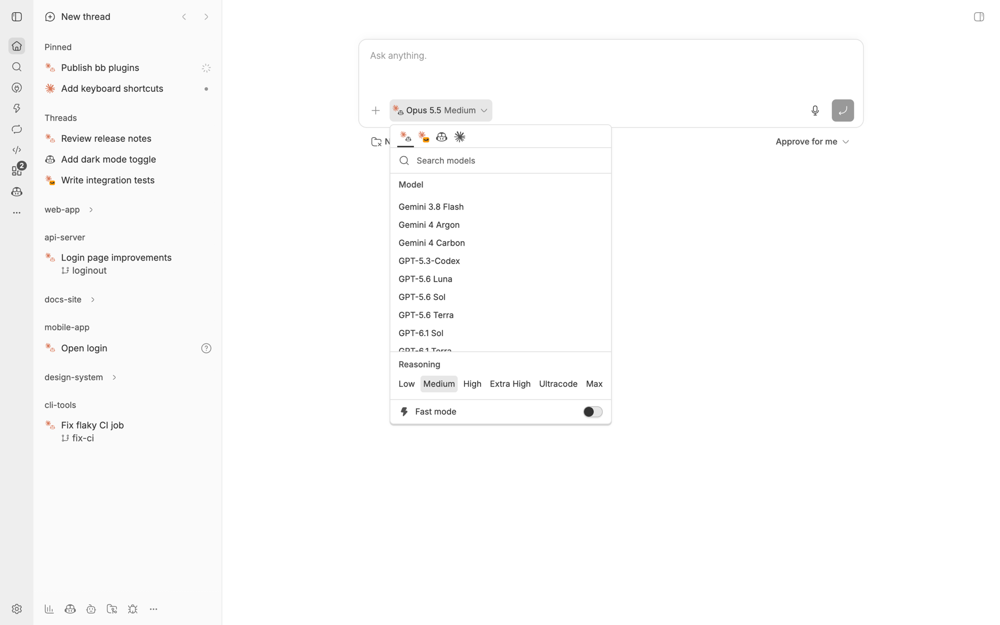
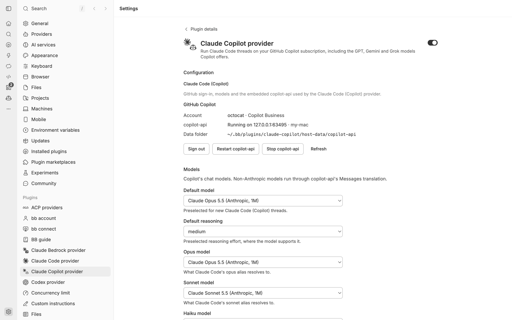
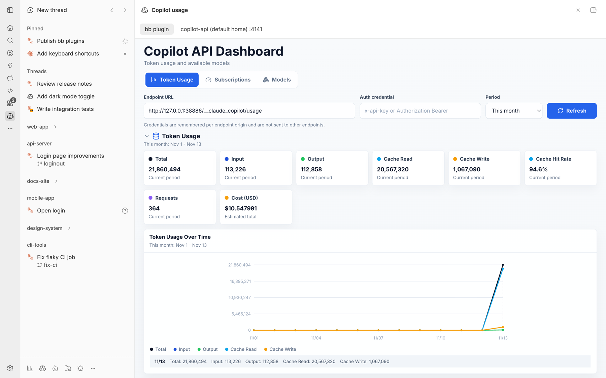

# bb-plugin-claude-copilot

**Claude Code (Copilot)** as its own bb provider: Claude Code running against
GitHub Copilot through an embedded
[copilot-api](https://github.com/caozhiyuan/copilot-api). It sits next to bb's
normal Claude Code provider, which keeps using your Anthropic login.

Status: prototype.

## Screenshots

**Claude Code (Copilot)** in the model picker, with GPT, Gemini and other
Copilot models next to the Claude models:



Settings: GitHub sign-in, copilot-api state and model mapping.



The **Copilot usage** page: copilot-api's token usage dashboard inside bb.



## How it works

- **bb's Claude Code provider, vendored.** `vendor/provider-claude-code` is
  bb's built-in Claude Code provider (`plugins/provider-claude-code` in
  [get-bb/bb](https://github.com/get-bb/bb), MIT), copied verbatim at a bb
  release; `vendor/UPSTREAM` names the tag and commit. bb maintains that
  plugin as forkable, so this plugin uses only public packages and a bb
  update can't break it. `server.ts` runs the upstream plugin with a wrapped
  plugin API instead of patching it: the provider is registered as
  `claude-copilot` (own name, icon and sign-in copy; usage maintenance, fast
  mode and claude.ai guided sign-in off; `BB_CLAUDE_CODE_EXECUTABLE` /
  `CLAUDE_CODE_OAUTH_TOKEN` not passed through), its settings are kept by
  this plugin, and its claude.ai usage RPC is dropped. `host.ts` wraps
  upstream's provider bridge (model catalog, below) and serves upstream's
  host handlers next to its own.
- **Embedded copilot-api.** Pinned in this plugin's `package.json`, run with
  bb's own Node (`ELECTRON_RUN_AS_NODE=1`), with its own `COPILOT_API_HOME`
  (`~/.bb/plugins/claude-copilot/host-data/copilot-api`), a random port and a
  generated gateway key (`auth.apiKeys`). A machine-wide copilot-api install,
  its `~/.local/share/copilot-api` state and port 4141 are not used.
- **Thread environment.** `bb.providers.experimental_contributeEnv` gives only
  this provider `ANTHROPIC_BASE_URL`, `ANTHROPIC_AUTH_TOKEN`, the Copilot model
  ids, `CLAUDE_CODE_DISABLE_NONESSENTIAL_TRAFFIC`, the `DISABLE_*` flags and
  plain `claude` as `BB_CLAUDE_CODE_EXECUTABLE`.
  `experimental_contributeEnvHealth` reports the provider healthy while the
  proxy runs, so no claude.ai login is needed.
- **Model catalog.** The bridge's model catalog is adjusted on its way to
  bb: every Copilot chat model is added (GPT, Gemini, Grok, ... run through
  copilot-api's Anthropic Messages translation, using its `my-claude-<id>`
  naming, with `[1m]` for models with a 1M context window), and the
  configured default model and reasoning level are preselected. The list is
  cached from copilot-api's `/v1/models` (`copilot-models.json`).
- **1M context.** Claude models get 1M through bb's normal Claude Code
  handling (the "Disable 1M context" option turns it off). For other models
  `[1m]` tells Claude Code the window is large; `CLAUDE_CODE_AUTO_COMPACT_WINDOW`
  is set to the smallest input limit among those models so it compacts
  before Copilot rejects a request.
- **Idle stop.** copilot-api stops when no Claude Code (Copilot) thread has
  been running for the configured minutes (default 30); the next turn starts
  it again through the env resolver.
- **Plan mode** and the rest of Claude Code's bb features come from the
  vendored declaration and bridge.
- **Icon.** The Claude mark and the GitHub Copilot glyph at equal size on a
  diagonal, Claude on top, both in Claude orange (`app.tsx`; `icons/claude-copilot.svg`
  is the monochrome fallback, `icons/claude-copilot-color.svg` and the 256 px
  `icons/claude-copilot.png` the colored one for the marketplace). The Claude Copilot ACP provider plugin uses
  the same mark in monochrome, so the two are easy to tell apart.

## In bb

- **Settings → Claude Copilot**: one section, owned by the plugin (not bb's
  declarative form) so it can be ordered and use live data: GitHub sign-in
  (device code), account and copilot-api state (start / stop / restart);
  model dropdowns from Copilot's model list (default model, default
  reasoning, Opus / Sonnet / Haiku mapping) and idle-stop minutes; bb's
  Claude Code options for this provider, rendered from the vendored
  provider's own setting descriptors; copilot-api's `config.json` (saving reloads it; the
  plugin-managed gateway keys are hidden and preserved).
- **Copilot usage** page and sidebar-footer button: copilot-api's usage
  dashboard in a sandboxed iframe whose data requests go through the plugin
  (`/viewer`, `/proxy` routes -> host entry), so it works from bb on a phone
  too. Tabs at the top switch between local copilot-api instances: this
  plugin's (default) and any other copilot-api home with a usage database, except
  other bb plugins' own (found from running copilot-api processes and the default
  `~/.local/share/copilot-api`). Token usage is stored per instance in its
  `copilot-api.sqlite`; other instances are read from a read-only snapshot
  (`VACUUM INTO`) with copilot-api's own query code (`usage-reader.mjs`).
  Subscriptions/quota data comes from GitHub and is the same for all.
- **Provider usage card**: the Copilot premium-request quota (percent used,
  reset date; the expanded row shows used / entitled AI credits in dollars,
  1 credit = $0.01). Background polls never start an idle copilot-api; they show
  the last value.

## Commands

```
bb claude-copilot status   Show the embedded copilot-api state
bb claude-copilot login    Sign in to GitHub Copilot (device code)
bb claude-copilot logout   Sign out of GitHub Copilot
bb claude-copilot start    Start copilot-api
bb claude-copilot stop     Stop copilot-api
```

## Staying in sync with bb

`scripts/sync-upstream.sh <tag>` replaces `vendor/` with bb's provider at a
release tag, e.g. `scripts/sync-upstream.sh desktop-v0.49.0`. Then:

```sh
npm install
npm run typecheck
npm test        # upstream's own tests
bb plugin build
```

The GitHub workflow `.github/workflows/sync-upstream.yml` does this every week
for the newest `desktop-v*` release and opens a pull request when the provider
changed. Review upstream's diff before merging, in particular changes to
`server.ts` and `src/host.ts`, and keep `package.json`'s dependency ranges in
step with upstream's. Permission and security fixes should be merged promptly.

## Develop

```
npm install
npm run typecheck
npm test
bb plugin build
bb plugin install .        # once
bb plugin reload claude-copilot
```

copilot-api's log: `~/.bb/plugins/claude-copilot/host-data/copilot-api.log`.

## License

MIT. `vendor/provider-claude-code` is bb's code under its MIT license
(`vendor/LICENSE`).
